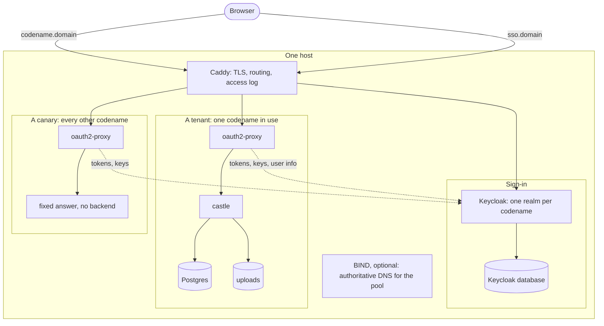
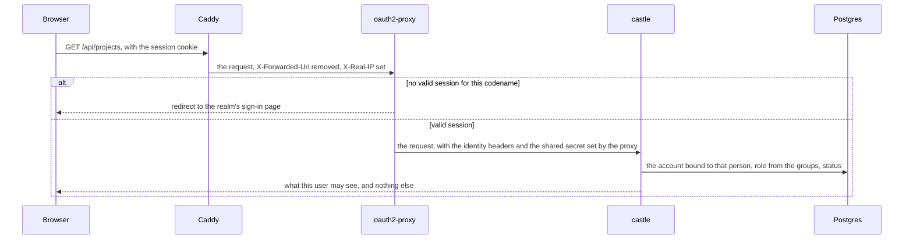
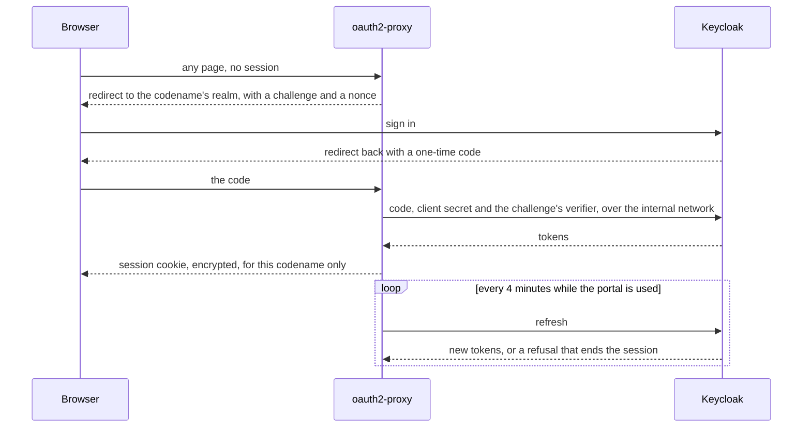

# Architecture and security model

How a deployment is put together, how a request and a sign-in travel through
it, and what the design defends against. Setting one up is in
[`deploy/compose/README.md`](../deploy/compose/README.md).

## One host

Every client gets a codename. A codename is a hostname, a Keycloak realm and,
once it is in use, its own castle and database. Codenames that are not in use
are canaries: they look the same from outside and have nothing behind them.

| Network | Joined by | Carries |
|---------|-----------|---------|
| `castle_edge` | Caddy, Keycloak, every oauth2-proxy | requests coming in from the edge |
| `castle_kc` | Caddy, Keycloak, every oauth2-proxy | the proxies' calls to Keycloak |
| `castle_kcdb`, internal | Keycloak and its database | Keycloak's own data |
| `castle_tenant_<codename>`, internal | that tenant's oauth2-proxy, castle and Postgres | one tenant's application and data |

Only Caddy publishes ports (80 and 443), and BIND when it is used (53). A
castle and its database are on their tenant's network and nowhere else. An
internal network is closed both ways: no other network is routed to it, and
what sits on it reaches nothing outside.

## A request

Castle takes who is asking from the headers the proxy sets, on every request,
and only from a request that carries the secret the two share: Keycloak's id
for the person, which the account is bound to, their address, name and groups.
The groups give the role (`castle-managers`, `castle-staff`,
`castle-clients`; someone in none of them is refused); the project memberships
that management keeps in castle give the rest. The rules are in the
[README](../README.md#access-control).

## A sign-in

The code is bound to the browser that started the sign-in: Keycloak starts no
sign-in for the client without a challenge and redeems the code only for the
verifier the proxy kept for that browser (PKCE), and the proxy accepts the
tokens only with the nonce it sent along.

A session lasts at most ten hours. Because it is refreshed with Keycloak every
four minutes, disabling a user there, ending their session or changing their
groups reaches the portal within that time. Sign-out ends the Keycloak session
as well.

## Security model

What is protected: the findings, drafts above all, with their discussion and
images; which codenames belong to clients; credentials and sessions.

### Boundaries

1. **Internet to edge.** Everything from outside is untrusted. Caddy serves
   the pool's certificates, which were issued in advance, and forwards a
   request to its codename's proxy. It removes the header a visitor could use
   to tell the proxy which path is being asked for, and sets the visitor's
   address itself. Every answer of every codename leaves with the same
   security headers, and none that names the software behind it.
2. **Edge to proxy.** oauth2-proxy lets a request through only with a valid
   session for that codename's realm. Every codename has its own realm, client
   secret and cookie secret, so a session for one is nothing to another.
3. **Proxy to castle.** Castle believes the identity headers of a request that
   carries the secret it shares with its own proxy, and of no other. Every
   codename has its own secret; the proxy puts it on everything it forwards,
   in place of what the browser sent, and castle does not start without one.
   The network is the second lock: castle publishes no port, and its tenant's
   network is internal, joined by that proxy and the database alone.
4. **Castle to data.** Authorization is decided per request in the handlers.
   Someone who is not on a project gets 404 for everything in it.
5. **The host.** The host, its operator and Keycloak's administrators are
   trusted. Tenants share a kernel.

### Threats and answers

| Threat | Answer |
|--------|--------|
| Forged identity headers | castle reads them only from a request that carries the secret it shares with its own proxy; the proxy sets them itself, in place of what a browser sends; the tenant's network is internal and castle publishes no port; the edge removes `X-Forwarded-Uri` |
| A request that another site starts in a signed-in browser | the session cookie is `SameSite=Lax`, and castle refuses a changing request that the browser does not mark as coming from the portal's own pages |
| One client reading another's findings | per tenant: its own castle, database, network, realm and secrets; within a tenant: membership per project |
| A client reading drafts | drafts and their comments go to project staff only: a manager, or someone who is staff both to Keycloak and on that project |
| Access outliving the person's role | the role is read on every request, the session is refreshed with Keycloak every four minutes and ends after ten hours, a disabled account is refused at once, and management removes memberships |
| An address that changes hands, or a person who changes address | an account is bound to Keycloak's id for the person: a new holder of an old address is refused and gets nothing of the old account, and a disabled or anonymized person stays that under any address |
| A page that says one thing while the server does another | a manager is on no project and is listed for each one as a manager; only memberships can be changed or removed, with a confirmation; a membership that gives less than it reads is marked |
| Losing what someone wrote when they leave | a user is never deleted: they are anonymized, and the database refuses to delete a user that anything points at |
| Guessed passwords | temporary lockout in Keycloak, no self-registration, no self-service password reset; the built-in login of `jwt` mode is throttled |
| Keycloak's administration reached from outside | to the world the sign-in host serves the pool's realms and Keycloak's static files; the master realm, the admin console and the admin API answer only a request that starts on the server; `castlectl` signs in as a service account with a secret and no password; the master realm locks out after failed sign-ins |
| Script in a finding or comment | Markdown goes through a sanitizer, diagrams render in mermaid's strict mode, and the Content-Security-Policy denies everything by default: scripts come from the portal's own files only, with no inline script or handler. The text itself is stored as written, since a finding may quote a payload |
| A hostile upload | the type is decided by the file's first bytes (PNG, JPEG, GIF, WebP), 10 MiB at most, stored under a random name, served to signed-in users with `nosniff` and a policy of its own under which it loads and runs nothing; a text can show an upload as an image and nothing else |
| Finding out which codenames are in use | tenants and canaries answer alike at the edge; certificates for the whole pool are issued and renewed in one batch; promoting a canary changes neither certificate nor DNS; a request by address or unknown name gets a neutral certificate; the bundled DNS allows no zone transfer |
| A sign-in code that reaches someone else | it is of no use in another browser: Keycloak redeems it only for the verifier kept for the browser that asked (PKCE), and the proxy accepts the tokens only with that browser's nonce; a code is used once and lives a minute |
| A stolen backup | bundles are encrypted on the host to a public key whose private half is kept elsewhere |
| An instance serving with a broken configuration | the settings are parsed strictly at start, `DATABASE_URL` and `JWT_SECRET` have no default, proxy mode does not start without its proxy's secret, and a logo that cannot be served stops the start |
| A tampered dependency or image | lockfiles; `cargo audit`, `npm audit`, Trivy, Semgrep and TruffleHog on every pull request and weekly; CI builds the image with provenance and an SBOM; `castlectl upgrade` resolves the image to a digest once, so every instance runs the same build |

### Limits

- Keycloak is trusted for identity: whoever controls it can sign in as anyone
  in that deployment.
- Tenants are separated by containers and networks on one kernel, not by
  virtual machines.
- One host is one copy of everything. The backups are what survives it.
